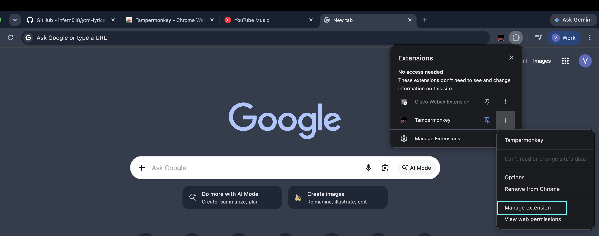
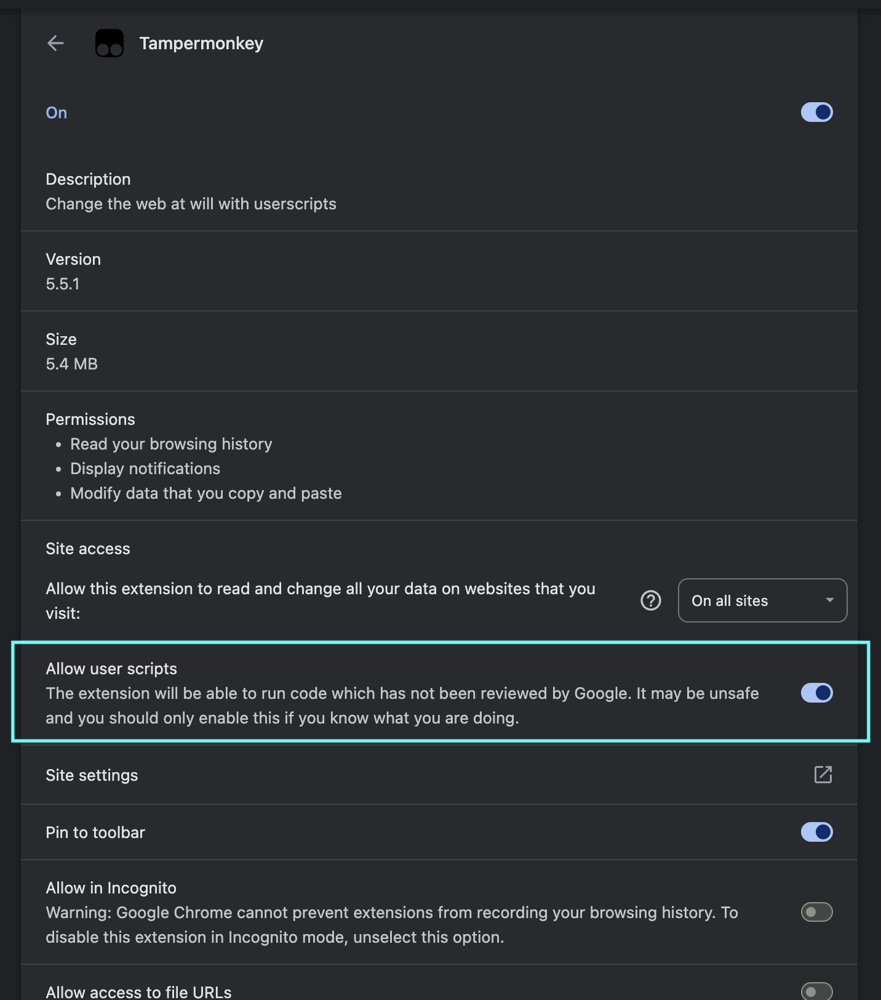

# YTM Fullscreen Synced Lyrics

A Tampermonkey userscript that adds a fullscreen, time-synced, auto-scrolling
lyrics overlay to the YouTube Music web player (music.youtube.com) — similar
to the lyrics experience on the YTM mobile app.

> **Note:** GitHub strips new-tab behavior from links in rendered READMEs, so
> links below will open in the same tab. Use Cmd/Ctrl+click (or middle-click)
> to open them in a new tab instead.

Lyrics are fetched from the free <a href="https://lrclib.net" target="_blank" rel="noopener">LRCLIB</a> database. Most
tracks will have synced (line-by-line timed) lyrics; if none are found, the
overlay falls back to plain lyrics, or shows a "not found" message.

## Install

1. Install the <a href="https://www.tampermonkey.net/" target="_blank" rel="noopener">Tampermonkey</a> browser
   extension (Chrome, Firefox, Edge, Safari all supported).
2. **For Chrome users only:** Enable **Allow User Scripts** in Tampermonkey
   (required by Chrome's Manifest V3 policy for user script managers):
   - Open extension settings by right-clicking the Tampermonkey icon (1) and
     selecting **Manage Extension** (2).

     

   - Locate and enable the **Allow User Scripts** toggle.

     
3. Click <a href="https://raw.githubusercontent.com/infern018/ytm-lyrics-overlay/main/ytm-lyrics-overlay.user.js" target="_blank" rel="noopener">this link</a>
   — Tampermonkey will detect it and prompt you to install. Click **Install**.
4. Go to <a href="https://music.youtube.com" target="_blank" rel="noopener">music.youtube.com</a> and play a song.

The script auto-updates whenever a new version is pushed to this repo.

Manual install (alternative)

1. Open the Tampermonkey dashboard → **Create a new script**.
2. Delete the placeholder content and paste in the contents of
   <a href="./ytm-lyrics-overlay.user.js" target="_blank" rel="noopener"><code>ytm-lyrics-overlay.user.js</code></a>.
3. Save (`Ctrl/Cmd + S`).

## Use

- A **LYRICS** button is added to the player bar. Click it to open the
  fullscreen overlay.
- The current line is highlighted and the view auto-scrolls to keep it
  centered as the song plays.
- Press **Esc** or click outside the lyrics (or the ✕ in the top-right) to
  close the overlay — playback is unaffected.
- Switching tracks (even without reloading the page) automatically fetches
  and loads new lyrics.

## Notes / limitations

- Synced lyrics quality depends entirely on what's available in the LRCLIB
  database — not every track has them.
- Track title/artist are read from the YTM player bar DOM, so if YouTube
  changes its page structure, selectors in the script may need updating.
